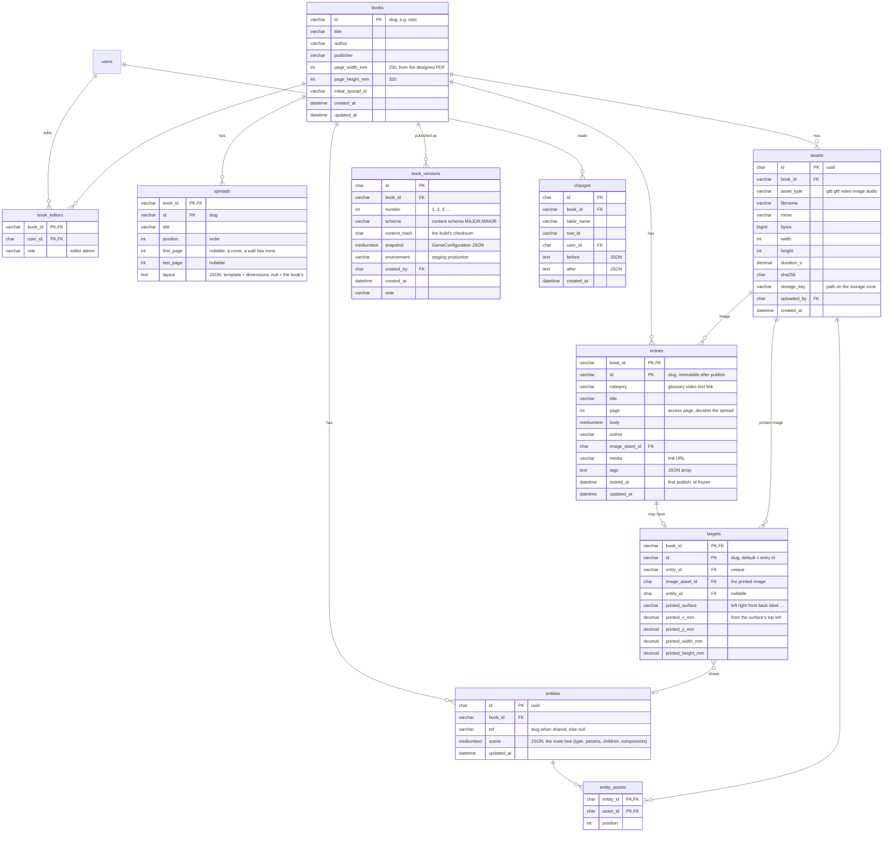

# Editor barebone and the book configuration in the database (#59 follow-up)

2026-10-28, for Tilman's decision. Tilman, while deciding the mock stage (#59): the preview should not sit in the
reader's debug overlay but in a separate **editor view** (`/editor`, lazily loaded only in edit mode), and the
book configuration should move into the **existing MySQL database** (accounts API, `server/api/`), so that Kévin
has "a good toy" when the content is made in Amsterdam (Phase 14). This note models that. It reopens the editor
question of 2026-10-02 (`content-editor.md`: "content changes stay with Claude Code"), now with a narrower goal –
not a full CMS, but the **placement and media toy** plus the data behind it.

## Short answer

- **The database holds the source, the content build stays the contract.** Kévin edits rows; a publish makes a
  snapshot, the content build turns it into `game.config.json` + media exactly as today, the CDN sync ships it
  (RULES #8, #24 untouched). The app never reads tables; the editor's live preview reads the **draft as a game
  configuration** from the API, through the same loader the CDN content uses (`VITE_CONTENT_BASE_URL` → `contentUrl`).
  Why still a file (Tilman asked whether the PWA could load progressively instead): the file is not about caching
  but about **immutability and offline** – a published build is one checksum-named folder on the CDN edge that the
  service worker caches whole, works without network and without a database on the readers' hot path, and can be
  rolled back by pointing `latest.json` elsewhere. What *is* progressive today is the media: spreads load their
  targets and assets per spread (`PreloaderService`, ±1 window). A per-spread configuration API would add little
  (the configuration is a few hundred kB) and would put the database in front of every reader. For editing, the
  draft endpoint is exactly that progressive, uncached path – for the editor only.
- **Ids are slugs and stay immutable after the first publish** – readers' progress references entry and target
  ids (RULES #10), so the table keys are `(book_id, id)` with `id = slug`, not surrogate UUIDs.
- **Schema-driven values stay JSON**: `params` (placement), `filters`, `tags` – the contract in `shared/` validates
  them, the editor's sliders come from the same specs (`PLACEMENT_PARAMS`, `FILTERS`), as the tune panel does today.
  Columns are for what the editor lists, sorts and joins (pages, titles, categories, assets).
- **Media are files on the storage zone, rows in the database**: upload → bunny storage (`<env>/uploads/<book>/…`),
  the `assets` row keeps name, type, size, dimensions and checksum. Transcoding (video 720p, GLB optimisation) stays
  in the build, where ffmpeg and the GLB tools are.
- **The editor is the app with a different front door**: route `/editor` → the AR scene with the mock tracker (#59)
  and the draft content, the tune panel as the placement UI, forms for texts and media around it. One lazy chunk
  (`editor/`), nothing of it in a reader's download.

## Data model



Notes per table:

- **books** – `BookData` plus the page format (the geometry issue: from the designed PDF) and the initial spread.
  One row today; the model is per book from the start (STRATEGY: instances per brand, several titles later).
- **spreads.layout** – the spread's physical shape for the editor's stage: a layout template (`book`, `sheet`,
  `cover`, `sleeve`, `wall`, `free` – the entity concept, "layout template per spread") with its dimensions in
  mm; null = the book's default (`books.page_*`, template `book`). Pages are optional metadata: a cover or a wall
  has none. The book is the first template, not the only one (Tilman, 2026-10-28).
- **spreads / entries / targets** – the content folders as rows, same fields as the YAML (`docs/content.md`),
  same checks (page inside one spread, ≤ 10 targets per spread – `MAX_TARGETS_PER_SPREAD` – run by the API on save
  and by the build on publish, from `shared/`).
- **targets** – `printed_*` carries the geometry from the PDF (mm from the top left corner of the named surface
  of the spread's template: `left` / `right` page of a book, `front` / `back` / `label` of a sleeve), which the
  mock stage places exactly and the trial protocol reports. Nullable until the layout import runs.
- **entities** – inline (one target) or shared (`ref` set, several targets point at it – today
  `content/entities/<ref>/entity.yaml`). `scene` is **one JSON document: the node tree** (type, placement
  `params`, type fields, `children`, `components` – the concept in `2026-10-28-entity-components.md`); today's
  one-node entity with `params` and `filters` is its simplest form, and it is the JSON the tune panel already
  produces ("Copy YAML" becomes "Save"). Not a row per node: the tree is edited, validated (by the specs in
  `shared/`) and versioned as a whole.
- **Onboarding steps stay out of the database** (Tilman, 2026-10-28: "müssen nicht in die Datenbank, auch
  zukünftig nicht") – they remain app content in the repository / content folder as today.
- **assets** – one row per uploaded file; the same file used twice is one row (`sha256`). What the editor shows:
  size against the mobile-data budget, dimensions, duration, a "used by" list through `entity_assets`, `entries.image`
  and `targets.image_asset_id`.
- **book_versions** – the publish history: the snapshot is the built `GameConfiguration` (what readers got), its
  content hash is the CDN folder name (`<env>/<build>/`, RULES #24). Rollback = publish an old snapshot again.
- **book_editors** – who may edit which book; `users` stay the readers' accounts (RULES #25 naming). Readers never
  see the editor; an editor is a user with a row here.
- **changes** – the audit and the undo: before/after per saved row. Cheap to write, and it answers "who moved the
  racoon" in Amsterdam.

Convention: times as UTC `DATETIME` written by PHP, JSON in `TEXT`/`MEDIUMTEXT` columns (as `progress.record`),
every statement additive and idempotent (`CREATE TABLE IF NOT EXISTS`, later `ALTER TABLE … ADD`), the same
SQL on MySQL and SQLite for the tests (RULES #25).

## Flows

```mermaid
flowchart LR
  pdf[Designed PDF] -->|osct import layout| db[(MySQL: books, spreads, entries, targets, entities, assets)]
  folder[content folder today] -->|osct content import-db, once| db
  editor[/editor: forms + mock stage + tune panel] <-->|/api/editor/…| db
  db -->|GET /api/books/osct/draft| preview[Draft as GameConfiguration]
  preview --> editor
  preview -->|?content=draft on a phone| phone[App on staging]
  db -->|publish: snapshot → book_versions| build[Content build: osct content pull --db → game.config.json + media]
  build -->|osct content sync| cdn[CDN env/build/]
```

1. **Seed**: a one-off `osct content import-db` reads the content folder (delivery 2110 as imported) into the
   tables and uploads the media to the storage zone. The folder stays the fallback until the database is the
   source for good; the fixture (`fixtures/content/`) stays a folder – the tests never need the database.
2. **Edit**: `/editor` (signed in, `book_editors` row) – spread list → entries and targets of a spread → an entry's
   form, its target image, its entity (type, assets, placement sliders on the mock stage, filters). Save writes
   the row and a `changes` row; the API runs the content checks and answers with the problems (RULES #16).
3. **Preview**: the editor's scene shows the draft at once (it *is* the app, fed by `/draft`). On the phone: the
   staging app opened with `?content=draft` loads the same draft over the printed page – the real check.
4. **Publish**: `POST /api/books/osct/publish` → `book_versions` row (snapshot, number) → the content build runs
   with `--db` (the Action `content.yml`, started by the API through a workflow dispatch, or by hand) → `osct
   content sync --env staging` → `latest.json`. Production = the same with `--env production`, by Tilman.
5. **Later**: the layout import from the PDF (geometry issue) fills `books.page_*` and `targets.printed_*`.

## The editor barebone (for Amsterdam)

The smallest useful toy, in order:

1. `/editor` route: a lazily loaded page (`client/src/editor/`, its own chunk) that mounts the AR scene with the
   **mock tracker and the mock stage** (#59) and the **tune panel** – placement and filters live over the simulated
   page. Sign-in through the existing accounts. ~#59's work plus a page and a route.
2. **Spread and entry list, entry form** (title, category, page, body, link), **target image upload**, **entity
   editor** (type, asset upload, placement = the tune panel, filters). Save to the database. ~3–4 days.
3. **Draft preview on the phone** (`?content=draft`) and **publish to staging**. ~1–2 days (the build's `--db`
   input and the dispatch).
4. Later: the node-tree inspector (content schema 2.0), the page map, the layout import, asset budget warnings, the look-around values.

What it does not do: 3D modelling (Blender), video cutting, several objects per target (a content-model change,
with Kévin), self-service for strangers (STRATEGY: contracted model).

## Open for Tilman (decide)

- Database as the source with the folder as fallback (proposal), or the editor writes YAML into the content
  folder through a file API (no new tables, but no multi-user, no history, Kévin needs the repository)?
- JSON for `params` / `filters` / `tags` (proposal) or fully normalised columns?
- Media on the bunny storage zone from the upload on (proposal), or on the staging server's disk first?
- `/editor` in production builds (lazy chunk, sign-in required) – or staging only until Amsterdam is over?
- Does this become milestone 2's first piece (instance = brand + editor + database) or stay an OSCT tool?
